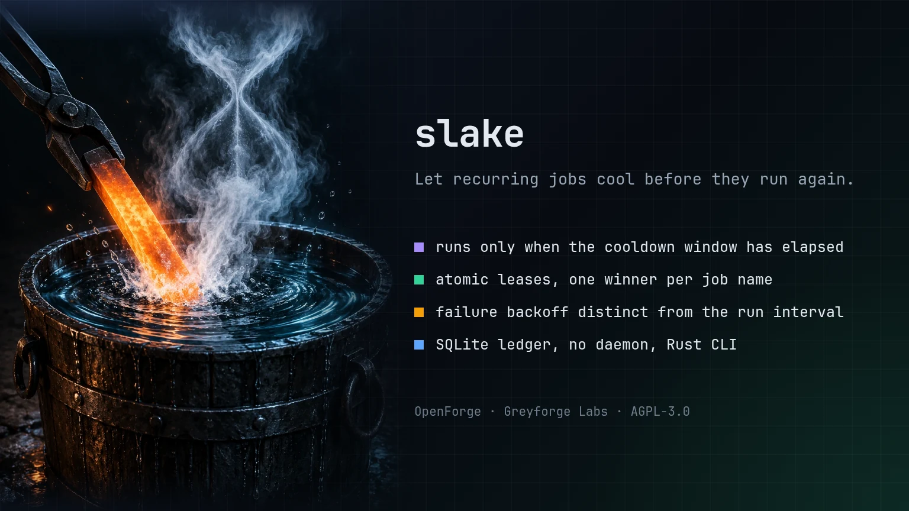
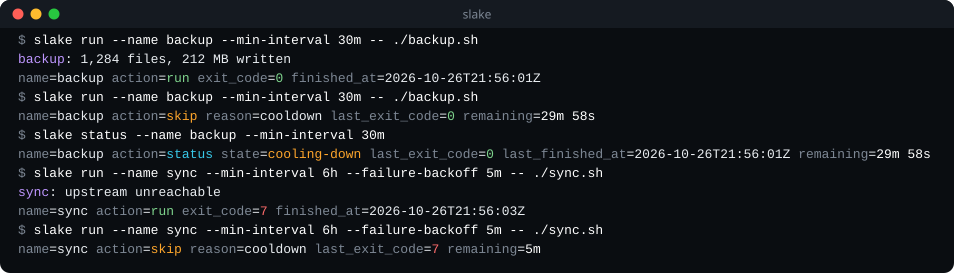

# slake

> Minimum-interval guard for cron jobs and recurring commands.

[](https://github.com/GreyforgeLabs/slake/actions/workflows/ci.yml)
[](https://github.com/GreyforgeLabs/slake/releases/latest)
[](LICENSE)

<p align="center">
  
</p>

`flock` stops two copies of a job from overlapping. It does nothing about cadence: a cron entry, a retry loop or an impatient human can still start the same job every minute. slake puts a minimum interval in front of any command. It keeps a small SQLite ledger of past runs and either runs the command or skips it with the time left. Failed runs get their own, usually shorter, backoff, so a broken job retries soon without hammering anything.

<p align="center">
  
</p>

## Install

Linux x86_64, prebuilt (no Rust toolchain needed):

```bash
VER=v0.5.1
PKG=slake-$VER-x86_64-unknown-linux-gnu
curl -fsSLO https://github.com/GreyforgeLabs/slake/releases/download/$VER/$PKG.tar.gz
curl -fsSLO https://github.com/GreyforgeLabs/slake/releases/download/$VER/$PKG.tar.gz.sha256
sha256sum -c $PKG.tar.gz.sha256
tar xzf $PKG.tar.gz
install -Dm755 $PKG/slake ~/.local/bin/slake
slake --version
```

If the shell answers `slake: command not found`, add `~/.local/bin` to your `PATH`.

Any platform with Rust 1.88 or newer (Linux and macOS):

```bash
cargo install --locked --git https://github.com/GreyforgeLabs/slake --tag v0.5.1
```

Coming from `cooldown-guard`? The tarball also contains the `cooldown-guard` alias (`cargo install` installs it too); see [Renamed from cooldown-guard](#renamed-from-cooldown-guard).

## Quick start

Put slake in front of a job and let the scheduler fire as often as it likes:

```cron
*/5 * * * * $HOME/.local/bin/slake run --name backup --min-interval 30m --failure-backoff 5m -- /usr/local/bin/backup.sh
```

Cron calls every five minutes. The backup runs at most once every 30 minutes, and after a failure it waits 5 minutes before the next try. Cron's `PATH` rarely includes `~/.local/bin`, hence the full path. Check where a job stands with `slake status --name backup --min-interval 30m`.

## Features

- **Minimum interval enforcement** - run a command only when its cooldown window has elapsed
- **Atomic leases** - same-name contenders have one winner while a claim is active, without holding a database transaction during the child command
- **Failure backoff** - give failed attempts a retry interval distinct from successful runs
- **Millisecond precision** - accepted durations preserve whole-millisecond values
- **SQLite state ledger** - durable run history with no daemon and no background service
- **Human and JSON output** - useful in shells, cron logs, and automation wrappers
- **Explicit subcommands** - `run`, `status`, and `clear`
- **Direct execution** - commands are spawned directly, not interpolated through an internal shell
- **Stop-signal forwarding** - `kill`, `systemctl stop` or a shutdown reaches the child, and slake still records the run and releases the claim

## Usage

```bash
# Run a job if 30 minutes have elapsed since the last completed attempt
slake run --name backup --min-interval 30m -- ./backup.sh

# Retry a failed command after 5 minutes, even though successful runs wait 30 minutes
slake run --name backup --min-interval 30m --failure-backoff 5m -- ./backup.sh

# Inspect current cooldown state
slake status --name backup --min-interval 30m

# Machine-readable output
slake --json status --name backup --min-interval 30m

# Clear completed history; refuses an active claim
slake clear --name backup

# Explicitly abandon an active claim when overlap is acceptable
slake clear --name backup --force
```

## Renamed from cooldown-guard

slake was released as `cooldown-guard` up to v0.3.0. Version 0.4.0 renames the crate, binary and repository to slake and keeps existing setups working:

- **Deprecated alias** - the `cooldown-guard` binary is still installed. It prints a one-line deprecation note to stderr and then behaves exactly like `slake` (same arguments, stdout and exit codes). Update cron lines and scripts to `slake`; the alias will be removed in a future release.
- **Existing ledgers keep working** - without `--db`, slake uses its own ledger (`~/.local/state/slake/runs.sqlite3` on Linux, `~/Library/Application Support/tech.Greyforge.slake/runs.sqlite3` on macOS) when that file exists. Otherwise, if a ledger written by `cooldown-guard` exists (`~/.local/state/cooldown-guard/runs.sqlite3` or `~/.local/share/cooldown-guard/runs.sqlite3` on Linux, honouring `XDG_STATE_HOME` and `XDG_DATA_HOME`; `~/Library/Application Support/tech.Greyforge.cooldown-guard/runs.sqlite3` on macOS), slake reads and writes that ledger in place. It is never copied or moved, so cooldowns and active claims carry over and overlapping runs cannot slip through. To move to the new location, stop scheduled jobs and move `runs.sqlite3` (plus any `-wal`/`-shm` files) into the slake directory.
- **Explicit `--db` paths** are used exactly as given.

## Guard Semantics

- The claim and finalize writes are short SQLite transactions. The child command runs after the claim commits, so unrelated jobs can proceed concurrently.
- `--lease` defaults to `24h`. It is a fixed, nonrenewing claim. Set it longer than the maximum expected command runtime. After expiry, another process may claim the job **even while the first child is still running**; the stale owner cannot finalize. The overlap guarantee lasts only for the lease, not for arbitrary child runtime.
- `--failure-backoff` defaults to `--min-interval` when omitted. It applies to spawn failures and completed commands with a nonzero exit.
- Duration values must be positive whole-millisecond values; `1ms`, `999ms`, and `1s` retain their exact cooldown meaning.
- Job names are 1–128 ASCII characters, start with a letter or digit, and otherwise use letters, digits, `.`, `_`, `:`, or `-`.
- The ledger retains the newest 1,000 completed attempts per job. Existing v0.1 second-precision rows migrate in place.
- SIGHUP, SIGINT, SIGQUIT and SIGTERM sent to slake while the child runs are relayed to the child; slake waits for it, records the result and releases the claim. Signals the caller ignores (for example SIGHUP under `nohup`) stay ignored for the child.
- A stop signal that arrives after slake started but before the command did (for example while slake waits for the ledger lock) gives the claim back and starts nothing. slake prints `action=stop reason=signal signal=N` (`"action": "stop"`, `"skipped": true` in JSON), records no run and ends like a signal-terminated run, so the job is not put into failure backoff.
- If the wall clock is set backwards, history and claims that now lie in the future are rebased to the current time on the next `run`, so the job waits one interval (or one lease) instead of until the clock catches up.
- The ledger schema revision is kept in `PRAGMA user_version`. Older ledgers are upgraded once, in place, on first open; ledgers stay readable by earlier releases.
- SQLite lock waits are bounded at five seconds and surface as runtime errors. `clear` refuses a live claim by default and changes nothing in that case. `clear --force` removes both history and an active claim; it does not stop a running child, so a new invocation may overlap it.

Example output:

```text
name=backup action=run exit_code=0 finished_at=2026-04-07T15:16:39Z
name=backup action=status state=cooling-down last_exit_code=0 last_finished_at=2026-04-07T15:16:39Z remaining=29m 58s
name=backup action=skip reason=cooldown last_exit_code=0 remaining=29m 41s
```

## Exit Codes

- `0` when a run is skipped because the cooldown is active
- Child process exit code when a command is executed
- `128 + N` when the command is terminated by signal `N`, or when stop signal `N` arrives before the command starts (the shell convention, for example `143` for SIGTERM); the output then also reports `signal=N` (`"signal": N` in JSON). For SIGHUP, SIGINT and SIGTERM, slake records and prints the result and then ends by the same signal, so a shell still sees `128 + N` while systemd and other supervisors see the signal death they would see without slake
- `2` on `slake` usage or runtime errors

## Uninstall

```bash
rm -f ~/.local/bin/slake ~/.local/bin/cooldown-guard   # prebuilt install
cargo uninstall slake                                   # cargo install (removes both binaries)
rm -rf ~/.local/state/slake                             # optional: the run ledger
```

On macOS the ledger lives in `~/Library/Application Support/tech.Greyforge.slake/`. A ledger you passed with `--db` stays where you put it.

## Development

```bash
git clone https://github.com/GreyforgeLabs/slake.git
cd slake
./scripts/setup.sh   # checks the toolchain, builds, runs the test suite
```

`setup.sh` is the contributor setup. It does not install anything; use `cargo install --locked --path .` from the checkout for that.

- [STARTHERE.md](STARTHERE.md) - coding client bootstrap
- [CONTRIBUTING.md](CONTRIBUTING.md) - contribution workflow and release checklist
- [CHANGELOG.md](CHANGELOG.md) - version history

## License

AGPL-3.0. See [LICENSE](LICENSE) for details.

---

<p align="center">
  <b>Useful?</b> <a href="https://github.com/GreyforgeLabs/slake">Star slake on GitHub</a> · <a href="https://x.com/GreyforgeLabs">Follow @GreyforgeLabs</a> · <a href="https://greyforge.tech/open-source">More OpenForge tools at greyforge.tech</a>
</p>

<p align="center"><sub>Background: the <a href="https://greyforge.tech/chronicles/slake-command-throttling">slake Chronicle</a> · <a href="https://greyforge.tech/llms.txt">Greyforge llms.txt</a></sub></p>
